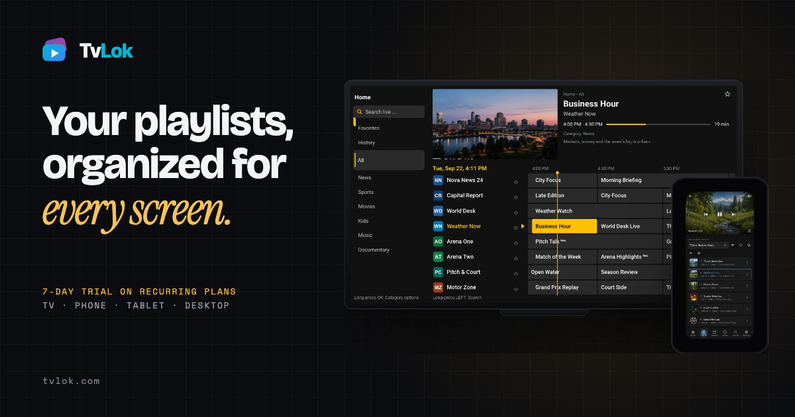
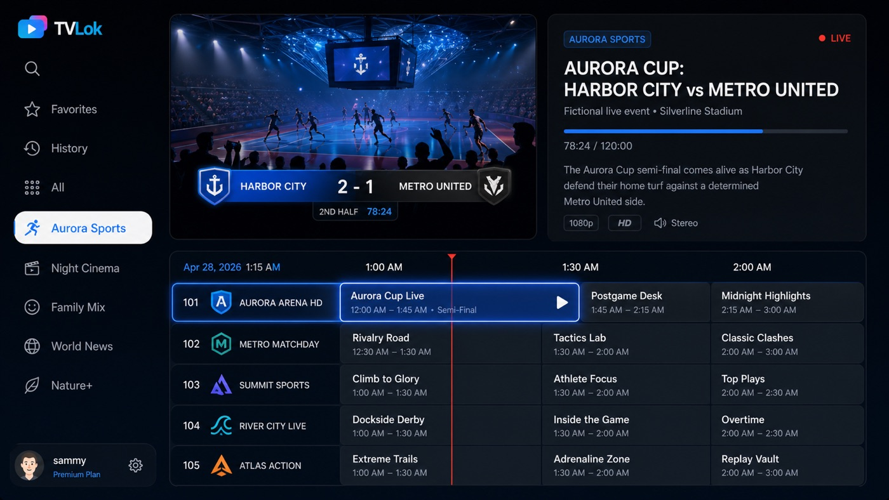
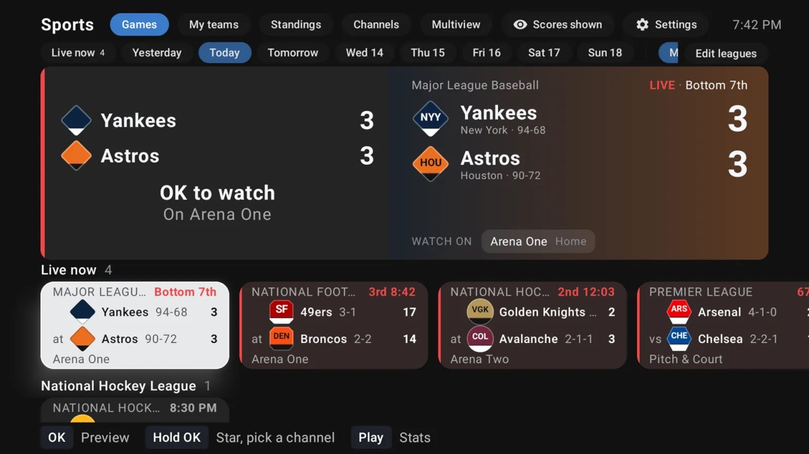
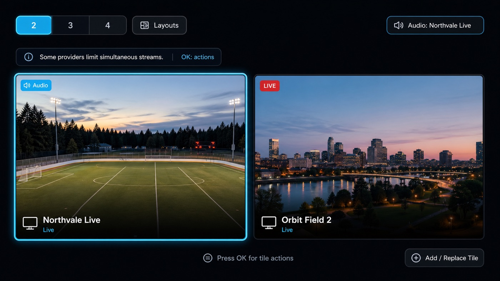
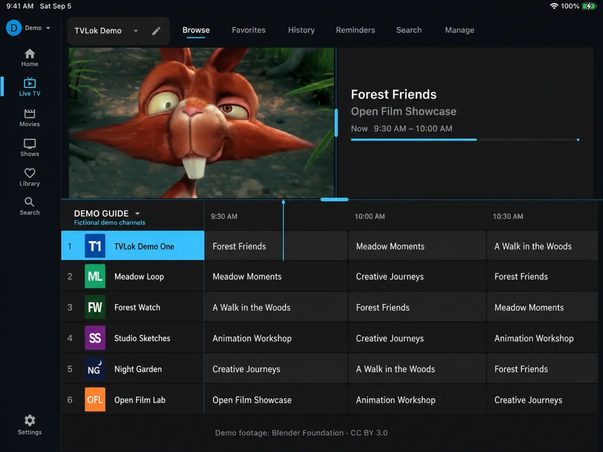

<h1 align="center">TVLok: the IPTV player for TV, phone and computer</h1>

<h3 align="center">Your playlist, on every screen. Set it up once.</h3>

<a href="https://tvlok.com"><strong>Get TVLok</strong></a> ·
<a href="https://tvlok.com/how-to">How-to guides</a> ·
<a href="https://discord.gg/UNHfkfftjX">Discord</a> ·
<a href="https://t.me/+HpdxyHA0Ik44ZGZh">Telegram</a> ·
<a href="https://www.reddit.com/r/tvlok/">Reddit</a>

TVLok is an IPTV player for Android TV, Google TV, Fire TV and Firestick, Android phones and tablets, iPhone and iPad, Mac and Windows. Add your M3U or Xtream playlist once and it feels like one service: the same channels, favorites and EPG guide everywhere, and the show you stopped in one room waiting in the next.

| | |
|:---:|:---:|
|  **The guide** |  **Today's games and the channels showing them** |
|  **Several channels at once** |  **The same setup on every screen** |

## Why people switch

- **Set it up once.** Sort your channels on tvlok.com from a laptop, then sit down and it's already on the TV. A new TV takes a sign-in, not a night of typing with a remote.
- **Sports that finds the game.** Today's games with the channels showing them. Follow your teams, pick your channel, watch several games at once.
- **An EPG guide you'll actually use.** Programs and catch-up on TV and phone, in the look you choose. Add your own XMLTV guide if your provider's falls short.
- **Record and multiview.** DVR recording, plus several channels on screen at once.
- **Your own media too.** Plex, Jellyfin and Emby, plus Trakt if you use it.
- **Built for the whole house.** Profiles, kids' rules with a daily limit and bedtime, and family members with their own login.

**Runs on** Android TV and Google TV, Fire TV, Android phones and tablets, Mac and Windows. iPhone and iPad are in public beta on TestFlight.

## Questions people ask

**What is TVLok?**
An IPTV player. You add your own playlist, and TVLok gives you the guide, favorites, recording and multiview, the same on every screen.

**Does TVLok come with channels?**
No. TVLok is a player only. You bring your own playlist.

**Which playlists work?**
M3U links, Xtream logins and Stalker portals.

**Does it work on Firestick and Fire TV?**
Yes, on Fire TV and Firestick as well as Android TV and Google TV. See [tvlok.com](https://tvlok.com) for the install steps.

**Is it a good TiviMate alternative?**
If you're moving from TiviMate, you can bring your playlists, favorites and history across in minutes. The big difference is your account: your setup lives there, so a new box is a sign-in away, not a night with a remote.

**Is there a free trial?**
Yes, 7 days on the monthly, 6-month and yearly plans.

## Talk to us

| I want to... | Go here |
|---|---|
| Report something broken | [Open a bug report](https://github.com/tvlokapp/tvlok/issues/new?template=bug.yml) |
| Suggest something | [Share an idea](https://github.com/tvlokapp/tvlok/issues/new?template=idea.yml) |
| Ask a question or show your setup | [Discussions](https://github.com/tvlokapp/tvlok/discussions) |
| Get quick help from people | [Discord](https://discord.gg/UNHfkfftjX) or [Telegram](https://t.me/+HpdxyHA0Ik44ZGZh) |

Posting here takes a free GitHub account and about a minute. Everything on this page is public, so never share playlist links, logins or provider names.

## About this repo

The app's code isn't here. This is where bugs, ideas and questions live. Downloads are at [tvlok.com](https://tvlok.com).

TVLok is a player only. It does not provide channels, streams, playlists or subscriptions.
